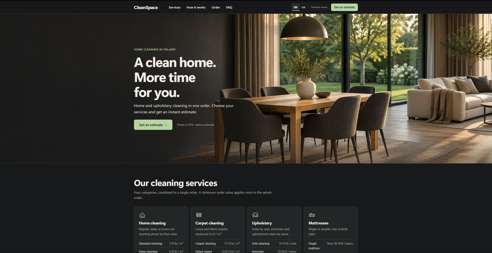
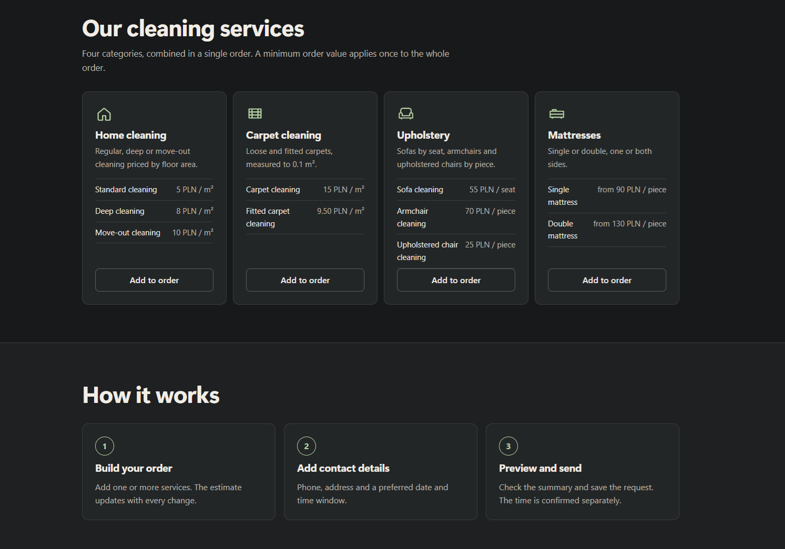
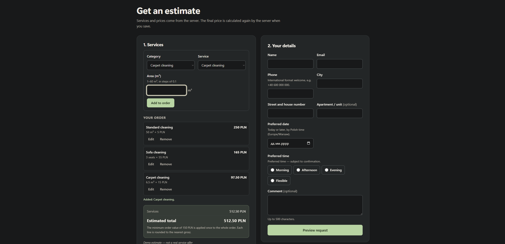
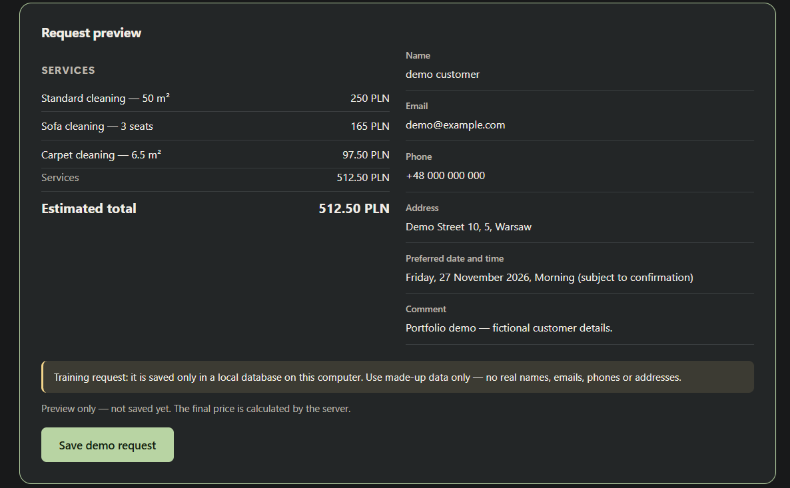
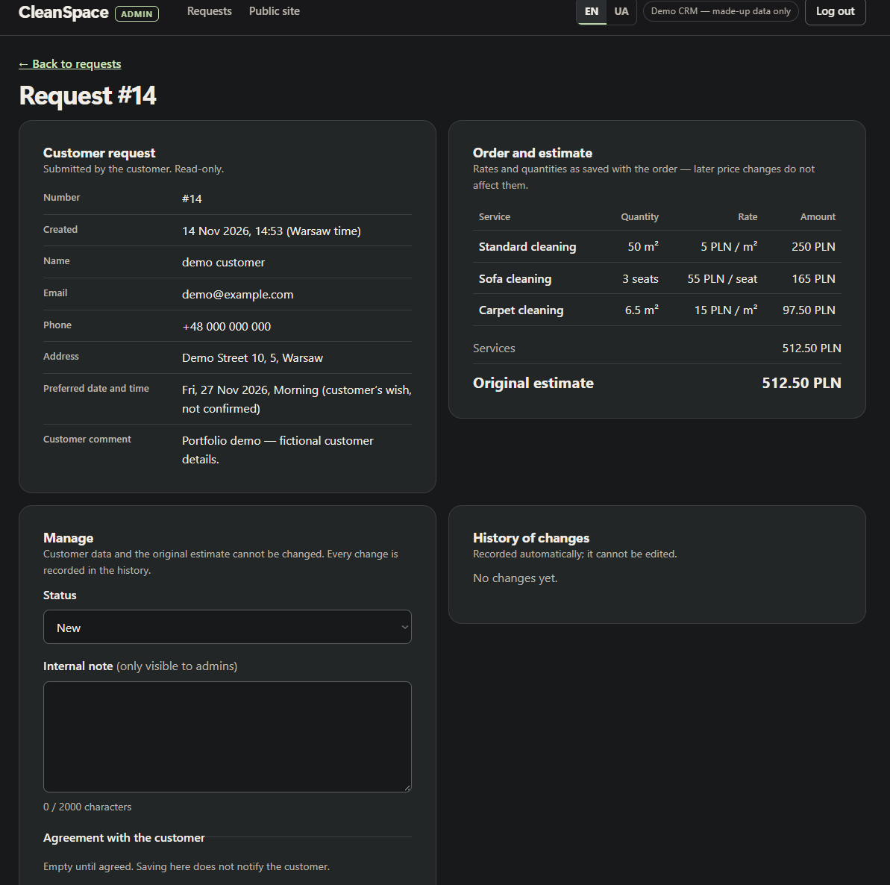
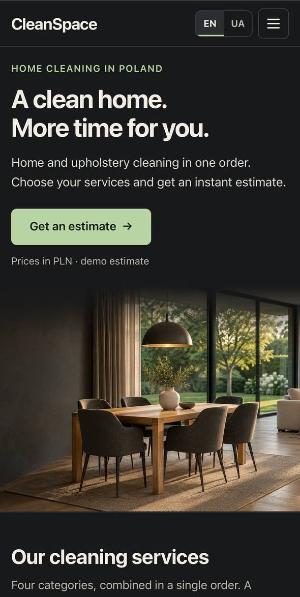

# CleanSpace

A portfolio project for a fictional cleaning service: a website where customers build an
order from several services and get an estimate, an admin CRM for handling the requests,
and Telegram notifications about new requests.



> **Learning project, not a production service.** CleanSpace is not a real company, the
> rates are demo values and all customer data in the screenshots is made up. The app runs
> on your own computer with a local SQLite database.

Detailed setup notes, the CRM API, the database schema and how delivery works are in
**[docs/setup.md](docs/setup.md)**.

## Features

- **English by default, Ukrainian on request.** An EN / UA switch on the site and in
  the CRM. The browser language is never used to pick a language, and an explicit choice
  is remembered. Switching keeps the form, the order and any message already on screen;
  it translates them again.
- **Four service categories, several services in one order:** home cleaning (by m²),
  carpets (to 0.1 m²), upholstery (per seat or piece) and mattresses (single/double, one or
  both sides). Lines can be edited and removed, and adding the same service again merges
  it into the existing line. An order can have up to 20 lines. A minimum order value
  (150 PLN) applies once per order.
- **Prices calculated and input checked on the server.** The browser shows a live
  estimate, but the server recalculates every line from its own rates and ignores prices
  sent by the browser. Money is handled in whole grosze with explicit half-up rounding.
  Every field is checked on the server; invalid input gets `422` with a code that names
  the field and the problem.
- **No duplicate requests on retry.** Each save attempt carries a request token. If the
  answer is lost and the user retries, the server returns the request it already saved
  instead of creating a second one.
- **Admin CRM:**
  - password login (hashed password, CSRF protection, login throttling);
  - search by number, name, email or phone, and a filter by status;
  - statuses (New / In progress / Completed / Cancelled) and internal notes;
  - agreed date, time and price (the price needs a reason);
  - an append-only history of changes;
  - detection of edits made at the same time in two tabs.
- **Telegram notification queue with retries.** Saving a request adds a job to a queue in
  the same database transaction. A separate worker sends a short message without
  personal data. Failed sends are retried with backoff, and Telegram's rate limit
  (`429 retry_after`) is respected, also after a manual retry from the CRM.
- **Responsive interface.** Checked at 320, 375, 393, 768 and 1440 px. It can be used
  with the keyboard, focus is visible, and user text is always inserted as plain text.

## Screenshots

| Services | Order builder and estimate |
|---|---|
|  |  |

| Request preview | CRM request details |
|---|---|
|  |  |

**Mobile:**



## Tech stack and architecture

- **Frontend:** HTML, CSS and plain JavaScript. No framework and no build step.
- **Backend:** Python, Flask, Flask-WTF (CSRF) and SQLite (built into Python).
- **Telegram:** Bot API over HTTPS through the standard library (`urllib`). No extra SDK.

```
Browser (HTML / CSS / JS)
   │  JSON over HTTP
   ▼
Flask app (app.py, admin.py) ── validation.py, pricing.py
   │  one transaction: request + order lines + queue job
   ▼
SQLite database (instance/cleanspace.db)
   ▲
   │  claims due jobs from the queue
Telegram worker (flask --app app telegram-worker) ──► Telegram Bot API
```

The website never calls Telegram directly. A request is therefore saved even when Telegram
or the internet is down; the worker picks up the job later. Rates and limits live in one
place (`config.py`) and the page loads them from `GET /api/pricing`. Schema changes are
versioned migrations with an automatic backup copy.

Secrets and data are kept out of the repository. The admin password hash, the session
secret, the Telegram token and the database are created locally in `instance/`, which
`.gitignore` excludes.

## Running on Windows

You need **Python 3.10 or newer** (developed and tested with Python 3.13). When installing
it, tick **“Add python.exe to PATH”**. Open **cmd** in the project folder.

**1. Create a virtual environment:**

```bat
python -m venv .venv
```

**2. Install the dependencies:**

```bat
.venv\Scripts\python -m pip install -r requirements.txt
```

**3. Set the admin password.** Input is hidden and asked twice; use at least 12
characters. Only a salted hash is stored.

```bat
.venv\Scripts\flask --app app set-admin-password
```

**4. Start the server.** The database is created on the first start.

```bat
.venv\Scripts\python app.py
```

**5. Open:**

- Website: <http://127.0.0.1:5000>
- Admin CRM: <http://127.0.0.1:5000/admin>

Stop the server with **Ctrl+C**. If port 5000 is busy, run `set CLEANSPACE_PORT=5050`
first and open port 5050 instead.

### Telegram notifications (optional)

The site and the CRM work without Telegram. To get a message about every new request:

**1. Connect a bot** you created with @BotFather. The command asks for the token (hidden
input) and shows a one-time code. You send that code to the bot in a private chat, then
confirm the chat that was found:

```bat
.venv\Scripts\flask --app app setup-telegram
```

**2. Optionally, send a test message:**

```bat
.venv\Scripts\flask --app app test-telegram
```

**3. Start the worker** in a **second** cmd window and keep it open next to the server:

```bat
.venv\Scripts\flask --app app telegram-worker
```

To turn the integration off again: `.venv\Scripts\flask --app app disable-telegram`.
Details are in [docs/setup.md](docs/setup.md#telegram-notifications-optional).

## Tests

```bat
.venv\Scripts\python -m unittest discover -s tests -v
```

The tests use a temporary folder and database and never touch `instance/`. Telegram is
replaced by fake responses (plus a local fake HTTP server on `127.0.0.1` for the real
transport), so no message is ever sent. They cover:

- **Prices:** the catalog, the rounding rule, the minimum order, prices sent by the browser
  being ignored, and old estimates staying the same after a rate change.
- **Validation:** order lines, contact fields, dates, and extreme numbers such as
  `1e999999`, `NaN` or `Infinity`, which must give `422`.
- **Saving:** idempotent saving, including a lost response followed by a retry and replay
  of old-format requests.
- **CRM:** login, CSRF, throttling, updates, the change history (append-only, written in the
  same transaction), price reasons and two-tab conflicts.
- **Telegram:**
  - delivery, retries and permanent errors;
  - `429` pauses with a controlled clock, including manual retries and restarts;
  - the uncertain-delivery flag;
  - settings that change while the worker runs;
  - no secrets in logs.
- **Database migrations** from every earlier schema version.

Last run on the author's machine: **125 tests, all passed, 0 skipped.** In a fresh clone,
one test is skipped: `test_real_backup_copy_migrates_without_loss` needs a local backup
copy in `_backup/`, which is not part of the repository.

## Limitations

- **A learning portfolio project, not a production service.** It runs on Flask's
  development server, without HTTPS. It has a single admin account without roles, no
  rate limit on the public API and no scheduled backups.
- **Demo data.** The rates are illustrative, not market prices, and every customer in the
  database and screenshots is made up.
- **No online payment and no availability check.** The preferred date and time window are
  only the customer's wish; nothing checks staff availability or books a slot.
- **Telegram duplicates are possible.** Delivery is at-least-once. If Telegram accepted a
  message but the answer was lost, a retry can send it twice. The CRM marks such jobs as
  *delivery uncertain*.
- **The worker must be started by hand** as a separate process. While it is not running,
  notifications wait in the queue.
- The Telegram bot token is stored in plain text in `instance/telegram.json`, protected
  only by the Windows user profile. There is one recipient chat.
- Requests cannot be deleted or exported. Email addresses are checked for format only.
- CRM search scans the whole table, which is fine for demo volumes.
- There are only two languages, and Telegram messages are English only.

More details are in [docs/setup.md](docs/setup.md#limitations).

## AI-assisted development

This project was built with the help of AI assistants, **ChatGPT and Claude**. The author
did not write all of the code by hand. The author:

- defined the requirements and the scope of each stage;
- reviewed the interface;
- walked through the manual scenarios in the browser (ordering, saving, the CRM,
  Telegram);
- decided what to change after each review.

The interior image on the homepage (`static/img/hero-interior.webp`) is **AI-generated**
for this demo. It is **not a photograph** and does not show work done by any real
cleaning company.
